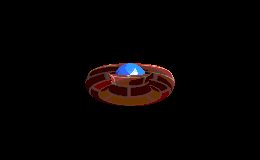

# 3d-x

A complete, dependency-free **3D graphics library for Go** — build and render 3D
content and animation in pure software. Linear algebra, parametric meshes, an
OBJ pipeline, procedural + image textures, Phong lighting, a scene graph,
keyframe animation, and a fixed-timestep loop. Output goes to a real image
(PNG / animated GIF) **or** straight to your terminal as 24-bit ANSI art.

No GPU. No cgo. No third-party modules — standard library only.

> Made with [CREADDINSCART STUDIO](https://www.shit.pub/studio/)
> Author: **CREADDINSCART STUDIO · Btoom KtCher (BKC)**



---

## Highlights

- **Math** — `Vec2/3/4`, column-major `Mat4` (translate/rotate/scale/perspective/
  ortho/lookAt/inverse), `Quaternion` (axis-angle, slerp, to-matrix).
- **Geometry** — `Cube`, `Sphere`, `Plane`, `Torus`, `Cylinder`, `Cone`,
  `Tetrahedron`, `Icosahedron` (subdivided geodesic), plus `ComputeNormals`,
  `Bounds`, `Transform`.
- **OBJ** — `LoadOBJ` / `LoadOBJFile` and `Mesh.SaveOBJ` with fan-triangulation,
  negative indices, and `i/j/k` corners.
- **Textures** — bilinear sampling with repeat / clamp / mirror wrap, from any
  `image.Image`, plus procedural `Checker`, `Gradient`, `Noise`/`FBM`, `Brick`.
- **Lighting** — ambient, directional, point (range falloff) and spot (cone),
  Blinn-Phong specular, emissive, flat / Gouraud / Phong shade modes.
- **Renderer** — homogeneous frustum clipping, z-buffer, perspective-correct
  interpolation, backface culling.
- **Framebuffer** — export to `image.NRGBA`, PNG, animated GIF, or ANSI truecolor
  half-block art with a 256-color fallback.
- **Scene graph** — hierarchical `Node` transforms with `World()` composition.
- **Animation** — easing library, `Tween`, `Vec3Track` keyframes, `Clip` and a
  `Scene`-driving `Animator`.
- **GameLoop** — fixed-timestep update/render driver.

---

## Install

The module lives on the studio registry path `creaddinscart.studio.go.sl/3d-x`.
Fetch it directly:

```bash
go get creaddinscart.studio.go.sl/3d-x
```

If your proxy cannot resolve the custom host, pull it in direct mode:

```bash
GOPROXY=direct GOFLAGS=-mod=mod go get creaddinscart.studio.go.sl/3d-x
```

Or vendor this folder into your module and use a `replace` directive:

```
require creaddinscart.studio.go.sl/3d-x v0.0.0
replace creaddinscart.studio.go.sl/3d-x => ./3d-x
```

Requires **Go 1.21+**.

---

## Quick start

```go
package main

import x3d "creaddinscart.studio.go.sl/3d-x"

func main() {
    fb  := x3d.NewFramebuffer(320, 200)
    cam := x3d.NewCamera(x3d.V3(0, 1.4, 4), x3d.Zero3, 320.0/200.0)

    scene := x3d.NewScene()
    scene.AddMesh("cube", x3d.Cube(1.6),
        x3d.NewMaterial(x3d.White).Textured(x3d.CheckerTexture(8, 8, x3d.Hex("#2b6cff"), x3d.White)))

    x3d.NewRenderer(fb, cam).Render(scene)

    fb.SavePNG("cube.png") // image output
    fb.Print()             // or: ANSI truecolor art to the terminal
}
```

### Animation

```go
clip := x3d.NewClip("bob")
clip.AddPosition("cube", []x3d.Keyframe{
    {Time: 0, Value: x3d.V3(0, 0, 0)},
    {Time: 1, Value: x3d.V3(0, 2, 0), Ease: x3d.EaseOutBounce},
})
an := x3d.NewAnimator(clip, scene)
an.Loop = true

gl := x3d.NewGameLoop(60)
gl.Run(func(dt float32) { an.Advance(dt) }, func() bool {
    x3d.NewRenderer(fb, cam).Render(scene)
    fb.Print()
    return true
})
```

### Animated GIF

```go
var frames []*x3d.Framebuffer
for i := 0; i < 40; i++ {
    // ... pose the scene ...
    x3d.NewRenderer(fb, cam).Render(scene)
    snap := x3d.NewFramebuffer(w, h)
    copy(snap.Pix, fb.Pix)
    frames = append(frames, snap)
}
x3d.SaveGIF("turntable.gif", frames, 6) // 6 cs per frame
```

---

## Examples

| Command | What it shows |
|---|---|
| `go run ./examples/cube`  | Textured, lit, spinning cube → PNG + one ANSI terminal frame |
| `go run ./examples/orbit` | Phong sphere + point light over a checker plane → PNG |
| `go run ./examples/gif`   | 40-frame turntable of a brick torus + glossy icosphere → animated GIF |

Run the test suite and benchmark:

```bash
go test ./...
go test -run '^$' -bench . ./...
```

---

## Layout

```
3d-x/
  math:      vec.go  mat.go  color.go  util.go
  content:   geometry.go  obj.go  texture.go  light.go  material.go
  pipeline:  camera.go  scene.go  render.go  framebuffer.go  gif.go
  motion:    anim.go  loop.go
  docs:      doc.go  README.md  LICENSE
  examples/  cube/  orbit/  gif/
```

All public symbols live in package `x3d` (import path ends in `3d-x`).

---

## License

[MIT](LICENSE) © 2026 **CREADDINSCART STUDIO**.

This project carries the CREADDINSCART STUDIO **Four Conditions of Use**
(author attribution, a visible “Made with CREADDINSCART STUDIO” line, a working
link to <https://www.shit.pub/studio/>, and source credit for any reused code).
See [`LICENSE`](LICENSE) for the full terms.

**Made with [CREADDINSCART STUDIO](https://www.shit.pub/studio/)**
